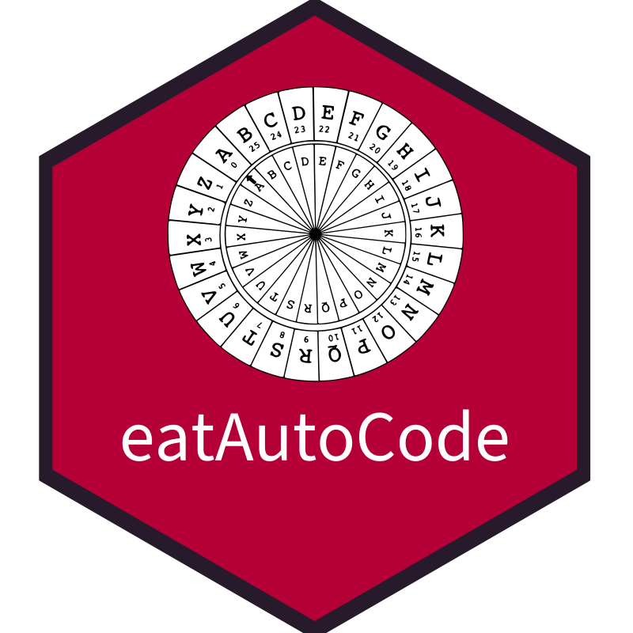

<!-- README.md is generated from README.Rmd. Please edit that file -->

# eatAutoCode 

<!-- badges: start -->

[](https://lifecycle.r-lib.org/articles/stages.html#experimental)
[](https://github.com/iqb-research/eatAutoCode/actions/workflows/R-CMD-check.yaml)
<!-- badges: end -->

The goal of eatAutoCode is to code responses from IQB Testcenter.

## Package governance

This package was originally authored and created by Philipp Franikowski.
**Current package maintenance** is provided by Karoline A. Sachse,
Kristoph Schumann, and Jakob Schaefer.

## Installation

You can install the development version of eatAutoCode from
[GitHub](https://github.com/) with:

``` r
# install.packages("devtools")
devtools::install_github("iqb-research/eatAutoCode")
```

## Update

If you cloned the repository, first run the regression tests against the
existing bundled autocoder in a fresh R session:

``` r
devtools::test()
```

The tests cover ordinary response values, codes and scores, derived
values, and source-status matrices. Keep these expected results
unchanged during the update so that differences can be reviewed
individually. The [valid-coding
matrices](https://iqb-research.github.io/eatAutoCode/articles/valid-coding-matrices.html)
describe the coverage and the comparison procedure.

Install the locked JavaScript dependencies, update the autocoder and its
required specifications, then rebuild the bundle and version metadata.
For the update to `@iqb/responses` 5.5.0, run these commands in the
repository directory:

``` sh
npm ci
npm install --save-dev @iqb/responses@5.5.0 @iqbspecs/coding-scheme@3.5.0 @iqbspecs/variable-info@2.1.0
npm run production
npm run updateVersion
```

R loads `inst/index.js`, so installing an npm package alone does not
update the autocoder used by eatAutoCode. `npm run updateVersion`
separately updates `inst/packageVersion.json` for the startup message.

Start another fresh R session and run the same tests, followed by the
package and documentation checks:

``` r
devtools::test()
devtools::check()
pkgdown::build_site()
```

Review any differences in status, value, code or score before changing
expected results. Commit the manifest, lockfile, rebuilt bundle and
version metadata together with the package version, changelog, tests and
documentation.

<!-- ## Example -->

<!-- This is a basic example which shows you how to solve a common problem: -->

<!-- ```{r example} -->

<!-- library(eatAutoCode) -->

<!-- ## basic example code -->

<!-- ``` -->

<!-- What is special about using `README.Rmd` instead of just `README.md`? You can include R chunks like so: -->

<!-- ```{r cars} -->

<!-- summary(cars) -->

<!-- ``` -->

<!-- You'll still need to render `README.Rmd` regularly, to keep `README.md` up-to-date. `devtools::build_readme()` is handy for this. You could also use GitHub Actions to re-render `README.Rmd` every time you push. An example workflow can be found here: <https://github.com/r-lib/actions/tree/v1/examples>. -->

<!-- You can also embed plots, for example: -->

<!-- ```{r pressure, echo = FALSE} -->

<!-- plot(pressure) -->

<!-- ``` -->

<!-- In that case, don't forget to commit and push the resulting figure files, so they display on GitHub and CRAN. -->
